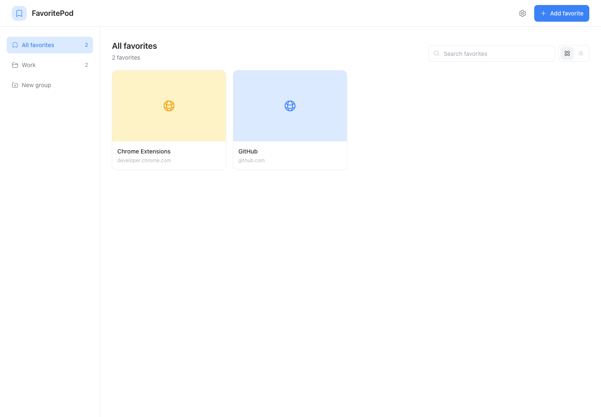
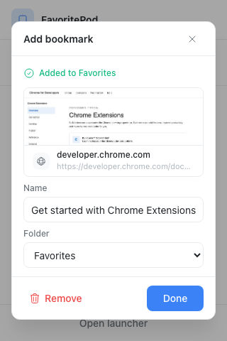
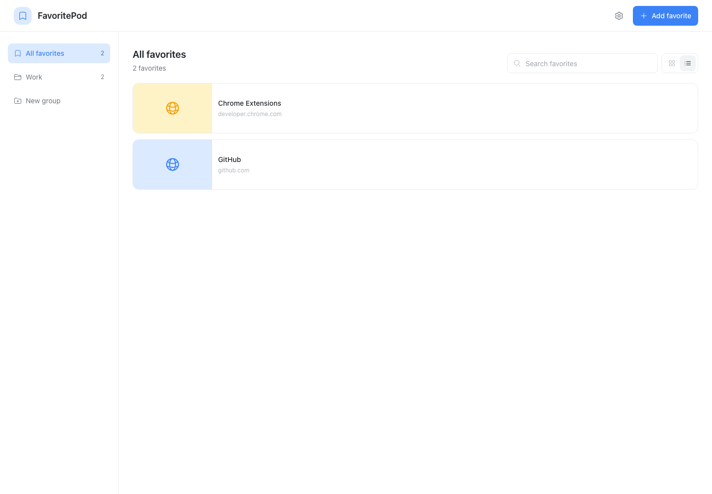
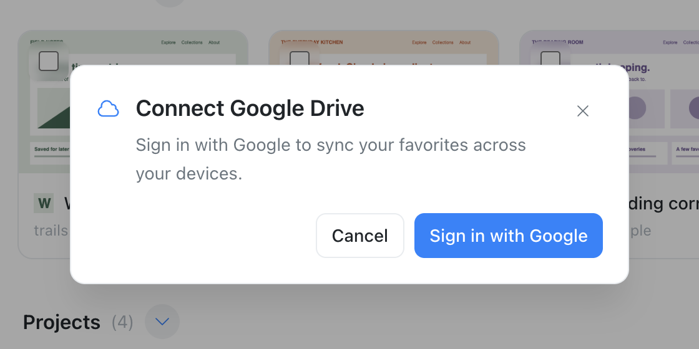

# FavoritePod

**Your favorite websites and local tools, together in one visual home.**

FavoritePod is a Chrome extension that helps you save pages, recognize them by their
previews, and find them again without digging through tabs. Organize your library
into folders, keep useful local files close by, and optionally sync your favorites
across devices with Google Drive.



_Screenshots show the current interface with sample content._

## What you can do

- **Save a page in a few clicks.** Capture a preview, give it a name, and choose a folder.
- **Find favorites visually.** Browse preview cards or switch to a compact list. Search by name or address.
- **Organize your way.** Create folders and subfolders, drag favorites into place, and move several items together.
- **Keep local tools handy.** Save links to local HTML pages and files alongside websites.
- **Sync when you want.** Connect Google Drive to share your library across Chrome profiles and devices.
- **Take a backup with you.** Export your library, including previews, to a ZIP file and import it later.
- **Discover pages to keep.** Optionally suggest pages from Chrome top sites and recent history.
- **Save from a right-click.** Enable page, link, and group actions in Chrome’s context menu.

## Save your first favorite

1. Open a page you want to keep.
2. Click **FavoritePod** in Chrome’s toolbar, then **Add bookmark**.
3. Review the preview, name, and folder, then click **Done**.

Choose **Open launcher** from the popup to see your full library. You can also add
an address directly from the launcher using **Add favorite**.



Previews are saved images of a page when you capture it. They help you recognize
favorites without loading every website in the background.

## Make the library your own

Use the sidebar to create and browse folders. Drag favorites to reorder them or
move them between folders, and use search to narrow down a larger collection.
Switch between the grid and list views to suit how you browse.



Hover over a favorite to see a larger preview and quick actions. You can edit its
name or address, copy its link, or open it. Undo and redo help you recover from
accidental library edits.

## Frequently visited and right-click saving

**Frequently visited** shows up to ten compact shortcuts above your library in
**All favorites**, in every grid/list view. Click to open a site. Its **…** menu
offers **Add to favorites**, **Edit favorite** if already saved, and **Hide
shortcut**. Saving opens the favorite editor so you can choose a group.

The section is shown by default. Hide it using its **…** menu or turn off
**Settings → Show frequently visited** for a cleaner layout. Showing it again
restores your shortcuts without changing your favorites.

Chrome access is separate: enable **Settings → Optional features → Frequently
visited access** to grant Top sites and History permissions. Shortcuts use top
sites and up to 500 history entries from the last 30 days. Hiding stops reads;
disabling access also removes those permissions. History stays in memory, and
hidden shortcuts and visibility stay in this profile. Only explicitly saved
favorites enter exports or Drive sync.

**Right-click save menu** adds **Save to FavoritePod** to page and link menus.
Choose a page, link, or destination group to open the existing Add favorite
dialog with its details filled in. Confirm to save, or Cancel to leave it out
of your library. Disable the setting to remove the menu.

## Use local files and tools

FavoritePod can save `file://` links, such as a local HTML dashboard, a reference
page, or a tool you keep on your computer.

To enable local file access:

1. Open `chrome://extensions`.
2. Find FavoritePod and click **Details**.
3. Turn on **Allow access to file URLs**.

Then open the local file in Chrome and save it through FavoritePod, or add its
address in the launcher.

If a folder has a different location on another computer, use **Settings → File
Locations Remap** to tell FavoritePod where to look on that device. This changes
how links open; it does not move your files.

**Local files themselves are not uploaded by Drive sync.** Their saved links and
preview images can sync, but the files must also exist on each computer where you
want to open them.

## Optional Google Drive sync

You can use FavoritePod without signing in. To sync your library:

1. Click the cloud button in the launcher, or open **Settings → Google Drive**.
2. Choose **Sign in with Google** in the dialog. In Settings, start with **Connect Google Drive**. Follow the prompts to confirm your account.
3. Connect the other Chrome profiles or devices you want to use to the same Google account.



If both the local library and Drive already contain favorites, FavoritePod asks
how to combine them. **Merge local and Drive data** keeps favorites from both
places. Review the replacement choices carefully if you want one library to
replace the other.

Your changes sync automatically while connected. Click the Drive button in the
header, or **Sync now** in Settings, to request a sync yourself. Settings also
shows recent sync activity and any problems that need attention.

When you are offline, your library and edits stay available locally. Sync resumes
when the connection returns. Websites still need an internet connection unless
they are available offline separately.

**Disconnect** stops sync only in the current Chrome profile. Your saved favorites
stay on that profile, your data stays in Drive, and other connected profiles and
devices can continue syncing.

## Back up or move your library

Open **Settings → Import and export**:

- **Export library** saves a ZIP file containing your favorites, folders, and preview images. You can export everything or selected folders.
- **Import library** lets you review a FavoritePod ZIP file before adding it. Choose whether to import a copy, update matching entries, or replace the local library.

Keep an export before removing the extension or making a large change to your
library. Local file links in a backup still need their original files on the
computer where you open them.

## Install the development version

FavoritePod is currently available here as a development project. The instructions
below build it from source and load it into Chrome.

You will need **Google Chrome**, **Node.js 20.19 or newer**, and **npm**.
Download or clone this repository, open a terminal in its folder, and run:

```bash
npm ci
npm run build
```

Then:

1. Open `chrome://extensions` and turn on **Developer mode**.
2. Click **Load unpacked** and select the project's `dist/` folder.
3. Pin FavoritePod from Chrome’s Extensions menu so it is easy to reach.

After building an update, click **Reload** on FavoritePod’s extension card and
reopen its popup or launcher.

Google Drive sign-in in the development build may be limited to approved test
accounts. Saving and organizing favorites locally works without Google sign-in.
Google Cloud and OAuth setup is for the person configuring the development build;
users of an already configured build only need to authorize access when they
choose to connect.

## Your data and permissions

Your favorites, folders, and previews are stored locally in your Chrome profile.
When you connect Google Drive, FavoritePod also stores its sync data in Drive’s
private app folder. The requested Drive scope is limited to that app folder.

FavoritePod uses Chrome permissions to capture the page you choose to save, read
its icon, store your library, and run optional Drive sign-in and background sync.
Access to local file URLs is controlled by the separate switch in Chrome’s
extension settings.

## Common questions

**Do I need a Google account?**

No. You can save, organize, search, and export favorites locally. A Google account
is only needed for Drive sync.

**Does removing a page from the popup’s recent list delete it?**

No. It removes the page from that recent list; the favorite stays in your library.

**Why does a local file work on one computer but not another?**

Check that local file access is enabled and the file exists there. Use **File
Locations Remap** if the folder path is different.

**What happens when Google Drive is full?**

Your local favorites remain available. Open **Manage storage** in Settings, free
up space in Google Drive, then try syncing again.

## For contributors

The app uses TypeScript, React, Vite, Tailwind CSS, and Dexie. For local development,
run `npm run dev` and keep that process running while using the unpacked extension.
Stop the development server before running `npm run build`; both write to `dist/`.

Run the project checks before submitting a change:

```bash
npm test
npm run type-check
npm run lint
npm run format:check
npm run build
```

- [Implementation plan](docs/IMPLEMENTATION_PLAN.md) — feature progress and acceptance criteria.
- [Code guide](docs/CODE_GUIDE.md) — architecture and development patterns.
- [Design guide](docs/DESIGN_GUIDE.md) — interface and accessibility conventions.
- [Development handoff](NEXT_STEPS.md) — local workflow and remaining work.
- [AI agent guide](docs/AI_AGENT_GUIDE.md) — guidance for automated contributions.

A project license has not yet been selected.
