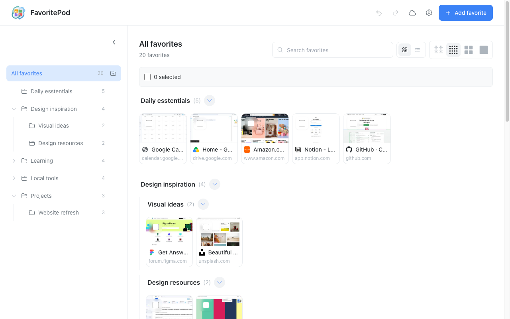
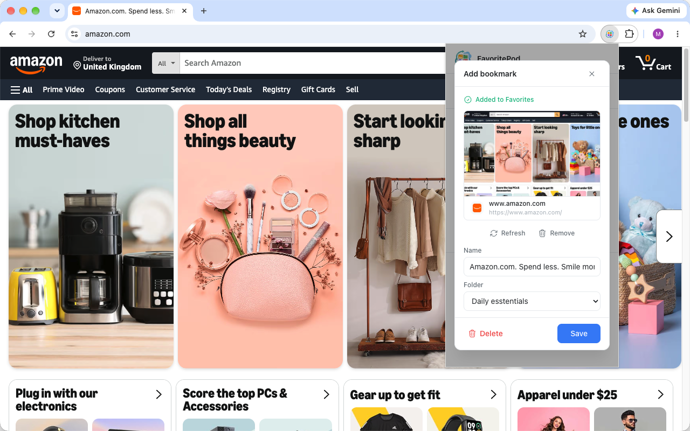
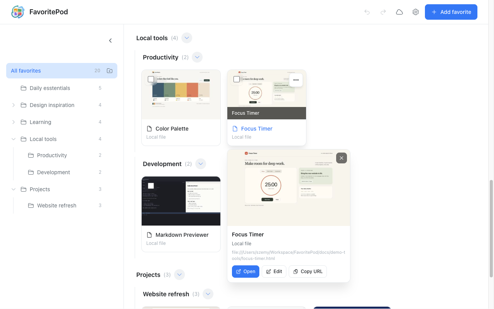
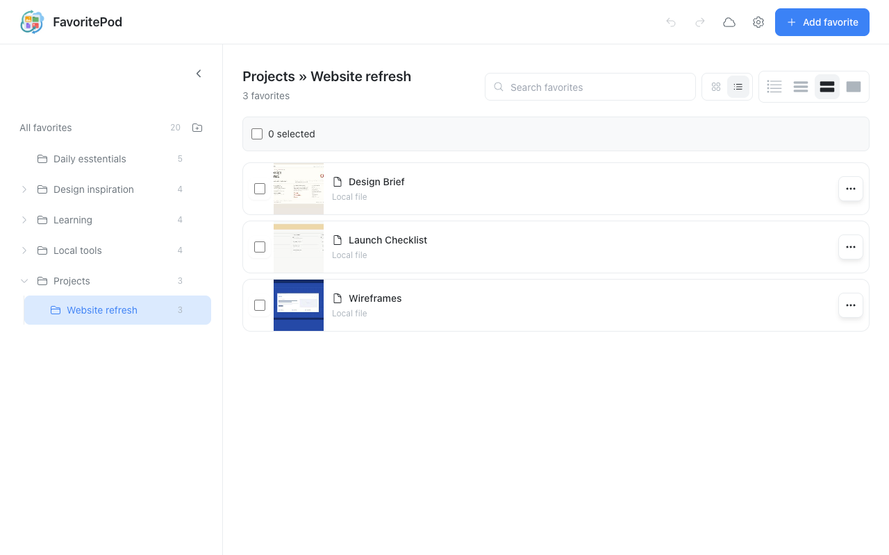
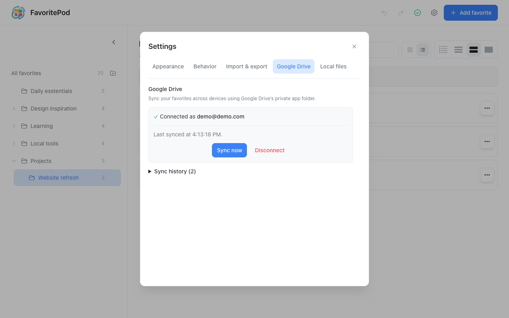

# FavoritePod

**Your favorite websites and local tools, together in one visual home.**

FavoritePod gives your bookmarks a visual home. Save a page with a preview,
organize it into folders, and recognize it at a glance when you need it again.
Keep research, daily essentials, project references, and local HTML tools
together instead of spreading them across open tabs and separate lists.

Browse preview cards or switch to a compact list, search by name or address,
and use nested folders to keep each project together. Your library works locally
without an account. Connect your own Google Drive only if you want to sync it
across Chrome profiles and computers.



_Screenshots use a demonstration library and sample account details._

## Features

- Visual bookmarks with previews, search, grid/list views, and nested folders.
- Local file links with device-specific path remapping.
- Optional Google Drive sync across Chrome profiles and computers.
- ZIP backups with previews and Chrome bookmark HTML import/export.
- Optional frequently visited shortcuts and right-click saving.

## A closer look

### Save a page while you browse

Open FavoritePod from Chrome's toolbar to save the current page with its title,
address, and an available preview. Choose a folder, edit the name, or refresh
the preview before continuing.



### Keep local tools beside your websites

Bookmark a local timer, Markdown previewer, design brief, or other HTML tool
alongside online resources. Previews help you recognize each tool; path remapping
handles folders stored in different locations on different computers.



### Organize a project your way

Use folders and subfolders for a project's references and working materials.
Switch between cards and lists, move items together, and use undo/redo to recover
from accidental library edits.



### Sync when you choose

Optional Google Drive sync keeps your library and previews together across
devices. Settings shows connection status and recent sync activity. Disconnecting
stops sync in that Chrome profile while retaining its local library.



## Install from source

Requires Google Chrome, Node.js **20.19+**, and npm. From the repository root:

```bash
npm ci
npm run build
```

Open `chrome://extensions`, enable **Developer mode**, choose **Load unpacked**,
and select `dist/`. Pin FavoritePod to the toolbar. After rebuilding, click
**Reload** on its extension card.

Drive sign-in requires an OAuth client configured for your extension ID.
The [publishing checklist](docs/publishing/README.md#6-check-google-sign-in-and-the-final-build)
covers that setup; local features work without Google sign-in.

## Get started

1. Open a page, click FavoritePod, and choose **Add bookmark**.
2. Review its name, folder, and preview, then click **Save**. The initial bookmark
   is saved automatically; closing the popup does not remove it.
3. Choose **Open launcher** to browse and organize your library.

For local files, enable **Allow access to file URLs** in the extension's Chrome
settings. Use **Settings → Local files → File Locations Remap** when paths differ
between computers. Drive sync transfers links and previews, not the original files.

Use **Settings → Import & export** for backups or importing Chrome bookmarks.
Export a backup before uninstalling or replacing your library.

## Privacy and support

Your library stays in your Chrome profile unless you connect Google Drive.
Optional sync uses FavoritePod's private Drive app folder. The extension includes
no ads or analytics. Check visible page content before capturing a preview.

Read the prepared [privacy policy](docs/publishing/wordpress/pages/privacy.html)
and [support page](docs/publishing/wordpress/pages/support.html), or email
[rockyroadstudio@outlook.com](mailto:rockyroadstudio@outlook.com).

## Development and publishing

Run `npm run dev` for development. Stop it before building; both write to `dist/`.

```bash
npm test
npm run type-check
npm run lint
npm run format:check
npm run build
```

- [Publishing checklist](docs/publishing/README.md) — website setup and private store release.
- [Documentation](docs/README.md) — developer guides, planning, and manual tests.
- [Changelog](CHANGELOG.md) — release notes.

A project license has not yet been selected.

## Use of AI

Generative AI assists with planning, implementation, review, testing, and
documentation. The maintainer is responsible for design decisions, review, and
releases. FavoritePod does not send your bookmarks or previews to an AI provider.

## Sponsor Me (With Thanks)

[](https://github.com/sponsors/SJoyTheHawk)
