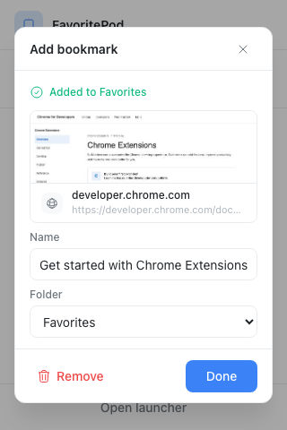
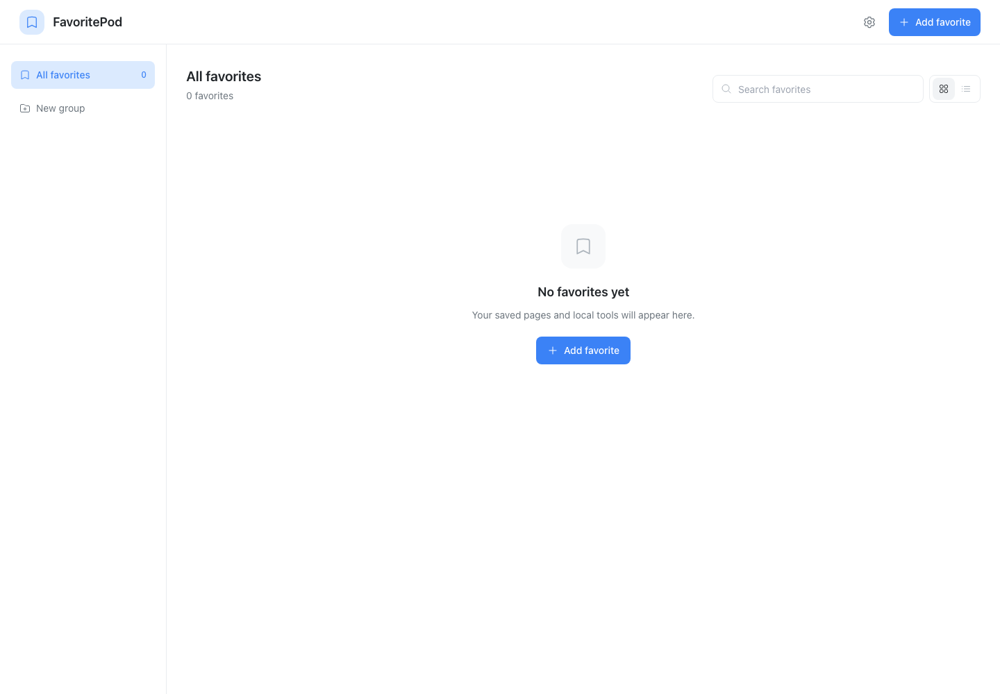
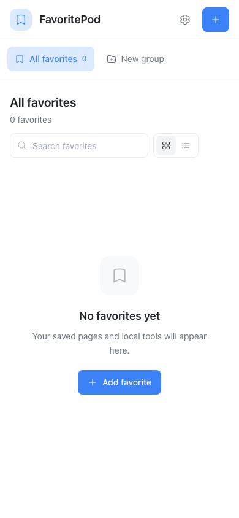
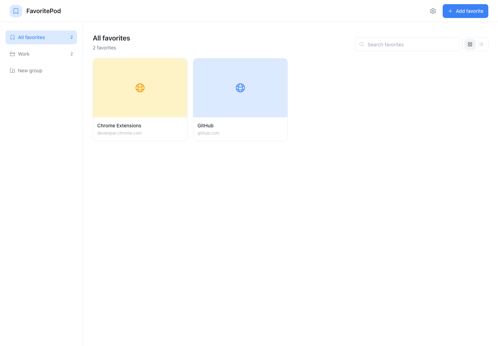
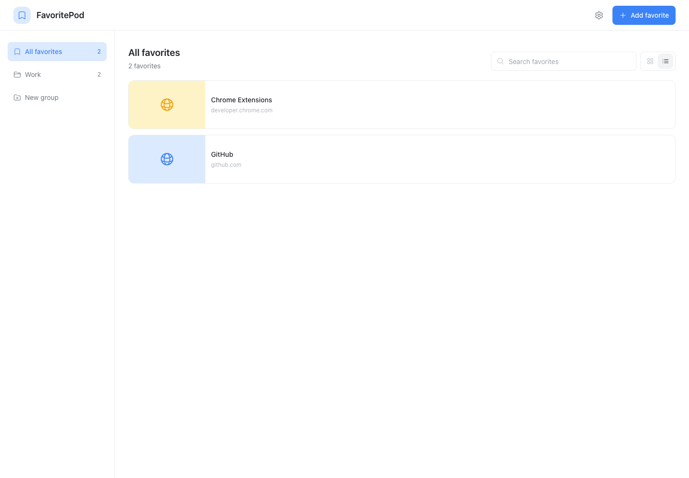

# FavoritePod Project Overview

Quick visual reference for understanding the project structure and workflow.

---

## 📁 Current Project Structure

```
FavoritePod/
├── public/manifest.json            # Manifest V3 extension configuration
├── src/
│   ├── popup/                      # Toolbar save flow
│   ├── dashboard/                  # Responsive launcher UI
│   ├── background/                 # Extension service worker
│   ├── core/                       # IndexedDB, HLC, merge, thumbnails
│   └── styles/                     # Design tokens and global styles
├── docs/                           # Project, implementation, code, and design guides
├── package.json
└── vite.config.ts
```

**Current status**: Phase 2 data-layer and Phase 3 popup/dashboard work are
implemented. Unit and production-build checks pass. Loading the unpacked build,
HMR, screenshot capture, and local-file opening still need manual Chrome checks.

## UI Captures

### Toolbar Popup



The capture shows the popup home screen behind the focused bookmark review dialog.
The page content and address are representative Chrome tab details.

### Empty Dashboard

Desktop:



Mobile:



### Grid and List Views

The populated examples use Chrome documentation and GitHub favorites.

Grid:



List:



---

## 🎯 V1 Scope Summary

### Primary Goal
**Perfect file:// link support** - Enable saving and opening local HTML tools

### Core Features (5 weeks)
1. Toolbar popup → Review and save the active page
2. Dashboard → Visual launcher with thumbnails
3. Groups → Flat organization (no nesting in v1)
4. Drag-and-drop → Reordering
5. IndexedDB → Local storage
6. ZIP → Import/export for sharing
7. **file:// → Full local file support** ⭐

### Deferred to V2
- Google Drive sync (complex, 4 weeks)
- Nested groups (simpler UX first)
- History discovery (optional permissions)
- Browser E2E testing (core logic and storage already have Vitest coverage)
- Advanced animations

---

## 🏗️ Future Architecture (When Built)

```
┌─────────────────────────────────────────────────────┐
│                 Chrome Extension                     │
├─────────────────────────────────────────────────────┤
│                                                      │
│  ┌─────────────┐  ┌─────────────┐  ┌────────────┐ │
│  │   Popup     │  │  Dashboard  │  │  Service   │ │
│  │             │  │             │  │  Worker    │ │
│  │ • Save page │  │ • Launcher  │  │            │ │
│  │ • Quick     │  │ • Edit      │  │ • Context  │ │
│  │   actions   │  │ • Settings  │  │   menus    │ │
│  └──────┬──────┘  └──────┬──────┘  └─────┬──────┘ │
│         │                │                │         │
│         └────────────────┼────────────────┘         │
│                          │                          │
│         ┌────────────────▼────────────────┐        │
│         │       Core Modules              │        │
│         │  • db.ts - IndexedDB            │        │
│         │  • storage.ts - CRUD            │        │
│         │  • thumbnail.ts - Capture       │        │
│         │  • file-links.ts - file://      │        │
│         │  • export.ts - ZIP out          │        │
│         │  • import.ts - ZIP in           │        │
│         └─────────────────────────────────┘        │
│                                                      │
├──────────────────────────────────────────────────────┤
│                  IndexedDB Storage                   │
│   Groups │ Items │ Thumbnails │ Settings            │
└──────────────────────────────────────────────────────┘
```

---

## 📖 Documentation Guide

### For Developers

**Starting out?** Read in this order:
1. README.md - Project introduction
2. docs/AI_AGENT_GUIDE.md - Quick start
3. docs/IMPLEMENTATION_PLAN.md - Pick a phase
4. docs/CODE_GUIDE.md - Technical patterns
5. docs/DESIGN_GUIDE.md - UI patterns

**Working on a specific feature?**
1. Find the phase in IMPLEMENTATION_PLAN.md
2. Read relevant CODE_GUIDE.md section
3. Reference DESIGN_GUIDE.md for UI
4. Implement following the patterns
5. Manual test using provided checklist

**Confused about requirements?**
- Check docs/project_plan.md (original detailed spec)
- But remember: v1 is simplified, focus on IMPLEMENTATION_PLAN.md

### For AI Agents

**Start here**: docs/AI_AGENT_GUIDE.md

Key points:
- Token-efficient: Manual testing, not automation
- Copy-paste ready: All code examples work as-is
- Modular: Build one module at a time
- Clear acceptance: Every phase has success criteria

---

## 🛠️ Technology Stack

```
┌─────────────────────────────────────────────┐
│             Development                      │
├─────────────────────────────────────────────┤
│ TypeScript 5.x    → Type safety             │
│ React 18          → UI framework            │
│ Vite 6.x          → Build tool + HMR        │
│ Tailwind CSS 3.x  → Utility-first styling   │
├─────────────────────────────────────────────┤
│             Core Libraries                   │
├─────────────────────────────────────────────┤
│ Dexie 4.x         → IndexedDB wrapper       │
│ fflate            → ZIP compression         │
│ zod               → Runtime validation      │
│ @headlessui/react → Accessible components   │
│ @heroicons/react  → Icon system             │
├─────────────────────────────────────────────┤
│             Chrome APIs                      │
├─────────────────────────────────────────────┤
│ chrome.tabs       → Capture + navigation    │
│ chrome.extension  → File access check       │
│ chrome.runtime    → Extension metadata      │
│ chrome.storage    → Settings (optional)     │
└─────────────────────────────────────────────┘
```

---

## 🚀 Development Workflow

### Phase Execution Pattern

```
┌──────────────────────────────────────────────────────┐
│ 1. Pick Phase from IMPLEMENTATION_PLAN.md            │
│    ↓                                                  │
│ 2. Read Relevant CODE_GUIDE.md Section               │
│    ↓                                                  │
│ 3. Implement Module/Feature                          │
│    • Follow TypeScript patterns                      │
│    • Use provided code examples                      │
│    • Reference DESIGN_GUIDE.md for UI                │
│    ↓                                                  │
│ 4. Manual Test                                       │
│    • Load extension in Chrome                        │
│    • Follow test checklist                           │
│    • Check console for errors                        │
│    • Verify in IndexedDB                             │
│    ↓                                                  │
│ 5. Fix Issues                                        │
│    • Iterate with AI agent                           │
│    • Debug using Chrome DevTools                     │
│    ↓                                                  │
│ 6. Move to Next Phase                                │
└──────────────────────────────────────────────────────┘
```

### AI Agent Collaboration

```
Human:
  • Reviews implementation plan
  • Assigns specific module/phase
  • Manual testing
  • Provides feedback

    ↕  (Iterate)

AI Agent:
  • Reads guides
  • Implements module
  • Provides test checklist
  • Fixes based on feedback
```

---

## 🎯 Key Design Decisions

### Why These Choices?

| Decision | Rationale |
|----------|-----------|
| **file:// priority** | Main differentiator vs. browser bookmarks |
| **Manual testing** | Token-efficient for v1, automate later |
| **IndexedDB** | Handles binary (thumbnails), unlimited storage |
| **Flat groups** | Simpler UX, faster to build, defer nesting |
| **No Drive sync in v1** | Most complex feature, validate core first |
| **TypeScript strict** | Catch errors early, AI-friendly |
| **Pure functions** | Testable, predictable, AI can reason about |
| **Tailwind CSS** | Fast iteration, AI can generate classes |
| **React** | Well-documented, AI agents know it well |

### Security Priorities

1. **URL validation** - Reject `javascript:`, `data:`, etc.
2. **File access** - User must explicitly enable
3. **No host permissions** - Use `activeTab` instead
4. **Local-first** - No external analytics or tracking
5. **ZIP validation** - Full validation before import

---

## 📊 Success Metrics (V1 Launch)

### Technical Goals
- Extension loads without errors (manual Chrome check pending)
- Popup opens in <100ms
- Dashboard loads in <500ms
- `file://` links open correctly (manual Chrome check pending)
- Thumbnails capture reliably (manual Chrome check pending)
- ZIP round-trip preserves data (planned)

### User Experience Goals
- Clear file access permission guidance
- Smooth drag-and-drop (planned)
- Intuitive group organization
- Helpful error messages
- Dark/light theme works (planned)

### Quality Targets
- Zero data loss bugs
- <5% error rate in manual testing
- All critical paths tested
- Clear documentation for users

---

## 🗺️ Timeline Overview

```
Week 1-2:   Foundation + Platform Spike
            ├─ Dev environment
            ├─ Extension identity
            └─ Validate risky APIs

Week 3:     Data Layer
            ├─ IndexedDB schema
            └─ CRUD operations

Week 4:     Basic UI
            ├─ Popup
            └─ Dashboard shell

Week 5-6:   Core Features + File Support ⭐
            ├─ Items & groups
            ├─ Thumbnails
            └─ file:// handling (PRIORITY)

Week 7:     Drag-and-Drop
            └─ Reordering

Week 8-9:   Import/Export
            └─ ZIP round-trip

Week 10:    Polish + Testing
            ├─ Theme switching
            ├─ Error states
            └─ Manual test all paths

────────────────────────────────────────

V1 LAUNCH 🚀

────────────────────────────────────────

Future:     V2 Development
            ├─ Google Drive sync (4 weeks)
            ├─ Nested groups (1 week)
            └─ Advanced features (3 weeks)
```

---

## 💡 Quick Tips for Development

### Chrome Extension Gotchas

1. **Service worker has no DOM**
   - No `document`, `window`, `localStorage`
   - Use IndexedDB and Chrome APIs only

2. **file:// requires special handling**
   - Can't use `<a>` tags
   - Must use `chrome.tabs.create()`
   - User must enable file access

3. **activeTab vs. host_permissions**
   - activeTab: Temporary access on user action
   - host_permissions: Scary permission prompt
   - Always prefer activeTab

4. **Memory leaks with blobs**
   - Always revoke object URLs
   - Use useEffect cleanup

5. **Extension updates**
   - Keep manifest.version stable
   - Users get auto-updates from store

### TypeScript Best Practices

```typescript
// ✅ Good: Explicit types
interface Item {
  id: string;
  url: string;
}

async function getItem(id: string): Promise<Item | null> {
  return await db.items.get(id) ?? null;
}

// ❌ Bad: Implicit any
async function getItem(id) {
  return await db.items.get(id);
}
```

### React Performance

```tsx
// ✅ Good: Memoize expensive operations
const thumbnailUrl = useMemo(() => {
  if (!blob) return null;
  return URL.createObjectURL(blob);
}, [blob]);

// ❌ Bad: Create on every render
function ItemCard({ blob }) {
  const url = URL.createObjectURL(blob); // Memory leak!
  return ;
}
```

---

## 🔗 External Resources

### Official Documentation
- Chrome Extensions: https://developer.chrome.com/docs/extensions/
- Manifest V3: https://developer.chrome.com/docs/extensions/mv3/
- IndexedDB: https://developer.mozilla.org/en-US/docs/Web/API/IndexedDB_API
- React: https://react.dev/
- Tailwind: https://tailwindcss.com/

### Libraries
- Dexie: https://dexie.org/
- Heroicons: https://heroicons.com/
- Headless UI: https://headlessui.com/

---

## 📞 When You Need Help

### For AI Agents
1. Check AI_AGENT_GUIDE.md first
2. Search CODE_GUIDE.md for patterns
3. Reference DESIGN_GUIDE.md for UI
4. Ask human for requirement clarifications only

### For Humans
1. Check README.md for project overview
2. Review IMPLEMENTATION_PLAN.md for roadmap
3. Search CODE_GUIDE.md for technical details
4. Consult project_plan.md for original requirements

---

## ✅ Ready to Build

You now have:
- ✅ Clear v1 scope (file:// priority)
- ✅ Complete technical documentation
- ✅ Design system and patterns
- ✅ Phase-by-phase roadmap
- ✅ AI-friendly architecture
- ✅ Manual testing approach

**Next step**: Start with Phase 1 (Foundation) in docs/IMPLEMENTATION_PLAN.md

Good luck! 🚀

